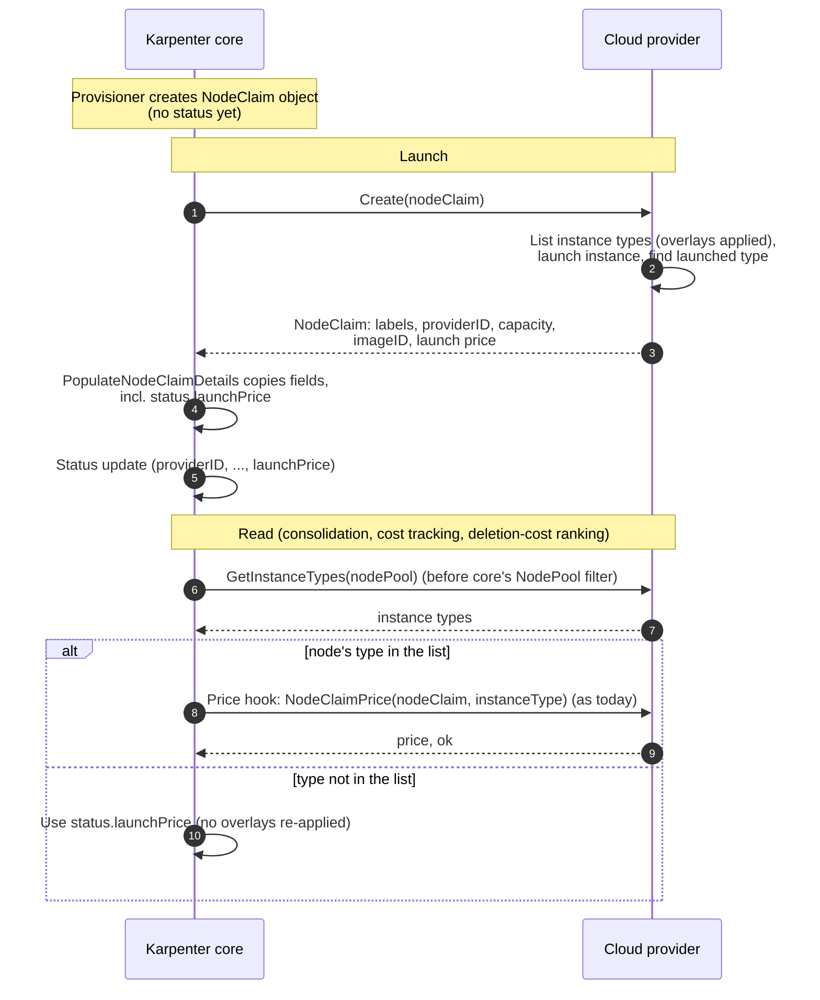

# Dropping Incompatible Offerings From GetInstanceTypes

> NOTE: this is still a work in progress

## Background

The `CloudProvider.GetInstanceTypes` contract requires providers to return every instance type, "even those with no offerings available" ([`types.go`](https://github.com/kubernetes-sigs/karpenter/blob/main/pkg/cloudprovider/types.go)), not just the ones the current NodeClass and NodePool can launch. Core relies on that in three places:

- **Pricing existing nodes.** Consolidation, cost tracking and pod deletion-cost ranking find a running node's price by looking up its instance type in the list. When the type is missing, the node has no price and consolidation refuses to touch it. The rule itself comes from this kind of dependency: it was added in June 2022 ([aws/karpenter-provider-aws#1773](https://github.com/aws/karpenter-provider-aws/pull/1773), commit [`1d3be60f`](https://github.com/aws/karpenter-provider-aws/commit/1d3be60f33547d883ba9954ae220b38d5fd13e73)) because cluster state and node initialization looked up each node's type by name to learn its capacity and extended resources, and the AWS provider's dropping of fully ICE'd types broke those lookups. Those particular lookups are gone, but pricing still depends on the list.
- **Uninitialized nodes.** Until a node registers, the scheduler reads its volume-attachment limits and DRA devices from its listed instance type.
- **Drift.** InstanceTypeNotFound drift ([#1787](https://github.com/kubernetes-sigs/karpenter/pull/1787)) replaces nodes whose type is no longer listed, which is how nodes on types the provider stops offering get replaced.

## Motivation

Currently, `Offering.Available=false` can carry more than one meaning. Core is provider-agnostic and the contract lets a provider set it for any reason. In the AWS provider, for example, it means either the offering is *temporarily* unusable (insufficient capacity, a zonal shift, subnet IP exhaustion) or it can *never* launch (the EC2NodeClass requires a feature the instance type doesn't support). The full list has two costs:

- **Correctness: transient vs permanent.** Some features need to know whether an unavailable offering will come back, and core can't tell:

  - **Terminate-first** ([#3415](https://github.com/kubernetes-sigs/karpenter/issues/3415)). When a capacity reservation is full and the on-demand fallback is unavailable, waiting for on-demand to return is the behavior we want: terminating first leaves the node's pods down until a replacement launches. But waiting is only right if on-demand will come back. Today static NodePools always wait (even on a fallback the NodeClass rules out) and dynamic NodePools never do.
  - **CapacityBuffers** ([#3318](https://github.com/kubernetes-sigs/karpenter/pull/3318)). Infeasibility detection treats a request that fails only on offerings as transient, so a buffer that only NodeClass-incompatible types could satisfy reports "waiting for capacity" forever instead of `Infeasible`.
- **Performance.** Each NodePool's list carries types it can never use, and every scheduling, consolidation and metrics loop pays for them in memory and CPU (e.g. [aws/karpenter-provider-aws#9163](https://github.com/aws/karpenter-provider-aws/pull/9163), which filtered the list by NodePool requirements, reported about 25% lower memory on a cluster with about 150 NodePools).

This RFC proposes **letting providers omit instance types that are incompatible with the NodeClass or NodePool, so a listed `Available=false` offering means transient**, and making core safe when an existing node's type is not listed. Core will drop types outside NodePool requirements for every provider, and will record each node's launch price on the NodeClaim so pricing no longer depends on the list.

### Terminology

- **Unavailable**: listed, with `Offering.Available=false`. Core treats it as transient: expected to recover without a configuration change.
- **Incompatible**: the instance type can never launch for the NodePool, either because the NodeClass rules it out (in AWS: a required network-interface count, nested virtualization, enclaves, or an AMI family the type doesn't support) or because it falls outside the NodePool's requirements.
- **Launchable**: an offering is launchable if it is available and, for reserved capacity, the reservation still has a free slot. `ReservationCapacity` is that count of free slots: a full reservation stays `Available=true` but is not launchable.

### Use Cases

1. **Terminate-first during a short ICE.** A NodePool prefers a capacity reservation and falls back to on-demand. The reservation is full, an AMI rolls / reserved node becomes unhealthy, and on-demand is ICE'd for a few minutes.

   1. *Today:* a dynamic NodePool terminates the reserved node first and its pods are down until a replacement launches; a static NodePool waits, but would also wait forever on a fallback the NodeClass rules out.
   2. *Desired:* terminate-first can rely on "unavailable means transient", so a follow-up can make both wait while on-demand is only temporarily unavailable.
2. **Large clusters with many NodePools.** Many NodePools, each constraining zone, capacity type or instance family.

   1. *Today:* every NodePool's list holds the whole NodeClass's types, inflating memory and scheduling, consolidation and metrics work.
   2. *Desired:* each list holds only what the NodePool can launch.
3. **CapacityBuffer infeasibility.** A CapacityBuffer requests something only NodeClass-incompatible types could provide.

   1. *Today:* those types are listed as unavailable, so the buffer reports waiting for capacity indefinitely.
   2. *Desired:* the types are omitted and the buffer reports `Infeasible`.

### Invariants

1. **Listed and unavailable ⇒ treated as transient.** Core may wait on it.
2. **A missing type or an empty list never blocks disruption and never causes drift on its own.** Drift, repair, emptiness, expiration and delete-only consolidation keep working.
3. **A provider that changes nothing keeps working.** Every non-drifted node it lists today is priced, scheduled and disrupted as today, even before it sets `status.launchPrice` in `Create`. The visible differences are the ones listed under Behavior Changes.

### Non-Goals

- **Changing terminate-first.** Making dynamic NodePools wait on transiently unavailable capacity ([#3415](https://github.com/kubernetes-sigs/karpenter/issues/3415)) is a follow-up that this RFC enables through Invariant 1.
- **Provider implementations.** Each provider decides whether and when to omit NodeClass-incompatible types. Providers that don't keep working (see Edge Cases).

## Proposal

The change is to the `GetInstanceTypes` contract. Two mechanisms make it safe and useful:

- **NodeClaim pricing**: so core no longer needs the list to price a running node
- **Filtering by NodePool requirements**: so every provider gets smaller lists. The sections after them describe how existing nodes whose type isn't listed are treated, and what behavior changes.

### Proposed Spec

The `CloudProvider` interface contract:

```go
// GetInstanceTypes returns the instance types the cloudprovider can launch for the 
// NodePool. Instance types that can never launch under the NodePool's NodeClass should 
// be omitted. Offerings that are returned with Available=false are treated by core as 
// temporarily unavailable (expected to recover without a configuration change). 
GetInstanceTypes(context.Context, *v1.NodePool) ([]*InstanceType, error)
```

| Cause | Who drops it |
| --- | --- |
| Outside NodePool requirements | Core, for every provider |
| Incompatible with the NodeClass | Provider (should) |
| Transient (e.g. ICE, zonal shift) | Nobody: listed with `Available=false` |

Omitting NodeClass-incompatible types is what makes "listed and unavailable means transient" hold, so providers should do it. A provider that omits NodeClass-incompatible types must also report a running node as drifted from `IsDrifted` when its type is no longer compatible (see **InstanceTypeNotFound Drift**).

One new optional status field on NodeClaim, holding the hourly price the node launched at, in the same units as `Offering.Price`. `Create` must set it on the NodeClaim it returns; core tolerates it being unset (see NodeClaim Pricing):

```yaml
apiVersion: karpenter.sh/v1
kind: NodeClaim
status:
  providerID: aws:///us-west-2a/i-0123456789abcdef0
  launchPrice: "0.0960"   # price per hour at launch; set once by Karpenter
```

### Core Filtering by NodePool Requirements

#### Proposal

```go
type decorator struct{ cloudprovider.CloudProvider }

func (d *decorator) GetInstanceTypes(ctx, np) {
    its, err := d.CloudProvider.GetInstanceTypes(ctx, np) // the wrapped provider
    return cloudprovider.FilterByNodePool(np, its), err
}
```

Core will drops instance types that can't satisfy the NodePool's requirements before anything else sees the list, for every provider. This never causes a node to be replaced: a node outside its NodePool's requirements is already drifted for that reason today.

> **Note**: We will drop whole instance types only, not individual offerings. Instance-type objects can be shared across NodePools and cache derived data, so trimming their offerings would mean copying every type on every call.

An additional method `GetUnfilteredInstanceTypes` can still used in cases where information for existing NodeClaims outside of NodePool requirements are needed (e.g. template resource slices)

### NodeClaim Pricing

#### Background

Several features need a running node's price.

- Consolidation uses it to decide whether deleting or replacing the node saves money (or for balanced it weights savings against disruption)
- Cost tracking adds it to each NodePool's cost metric (only done at node join)
- Pod deletion-cost ranking uses it to order nodes

Consolidation and pod deletion cost look the price up from the node's listed offering when it needs it, so changes reach them quickly: a NodeOverlay price change or new provider price data as soon as the provider refreshes it (every 12 hours in AWS).

The `NodeClaimPriceProvider` (introduced in [#3457](https://github.com/kubernetes-sigs/karpenter/pull/3457)) is not part of `GetInstanceTypes`, but an optional interface that a provider can register at startup that, given a NodeClaim, returns the node's hourly price. The `DefaultNodeClaimPriceProvider` ([code ref](https://github.com/kubernetes-sigs/karpenter/blob/81514ea717a407c142b0cf861624e12c5915be6b/pkg/cloudprovider/types.go#L1016)) prices a NodeClaim from the offering in its listed instance type that matches its zone and capacity type, p by `GetInstanceTypes`.

#### Proposal

> This RFC proposes a new status field on the NodeClaim, `status.launchPrice`.

##### Hydration

When the node launches, the provider's `Create` **MUST** set the price on the NodeClaim it returns, the same way it returns `status.providerID`. Karpenter copies it into `status.launchPrice`. This is the price the provider launched the node at, **without** NodeOverlays applied.

Karpenter will not update the field after launch, and will not backfill NodeClaims launched before the upgrade (to reduce writes on upgrade).

##### Consumers

Consolidation, cost tracking, and deletion-cost ranking will keep using the live price: they ask the price hook (as they do today) and look the nodes type up in the provider's list before core's NodePool filter. They only fall back to `status.launchPrice` when the type isn't in that list (e.g. a type a provider stopped offering, providers filtering out NodeClass incompatible instance types). The current state of NodeOverlays are re-applied to it.

There may **not** necessarily be a `status.launchPrice`: which can happen because of a providers non-compliant `Create` or for NodeClaims launched before the upgrade.

**When there's no price.** If the nodes type isn't in the list and there's no `status.launchPrice`, we will treat the Node as `MaxInt` for consolidation and `0` for cost tracking.

**Note**: This is **not** the behavior today. See the **Existing Nodes Whose Type Isn't Listed** section.

##### Reserved Capacity

`status.launchPrice` is the price Karpenter uses for decisions, not the billed rate. For example, the AWS provider prices reserved offerings at the on-demand price divided by 10,000,000, so reservations look nearly free while keeping their relative order. `status.launchPrice` shows that value for reserved nodes.

### Existing Nodes Whose Type Isn't Listed

A nodes type can be missing from its NodePool's list in three cases:

- the NodeClass changed after launch and now rules the type out
- the NodePools requirements changed after launch
- the provider stopped offering the type (i.e. instance retirement)

Core uses an existing node's type in four places:

| Where core uses the node's type | Behavior when it is missing |
| --- | --- |
| Whether the node can be disrupted (candidate building, consolidation) | The node stays a candidate and consolidation no longer requires the type, only a price. |
| The node's price (consolidation, cost tracking, pod deletion-cost) | Live price as today, falling back to status.launchPrice; see **NodeClaim pricing** |
| Scheduling onto existing nodes | see **Scheduling Onto Existing, Uninitialized Nodes** |
| InstanceTypeNotFound | see I**nstanceTypeNotFound Drift** |

#### InstanceTypeNotFound Drift

InstanceTypeNotFound drift ([#1787](https://github.com/kubernetes-sigs/karpenter/pull/1787)) is for nodes whose instance type, or zone/capacity-type offering, the provider no longer offers.

Today, the drift controller runs the `InstanceTypeNotFound` check before asking the provider. The ordering is:

1. Check if NodePool static and requirements drift
2. Check if `InstanceTypeNotFound` ([code ref](https://github.com/kubernetes-sigs/karpenter/blob/81514ea717a407c142b0cf861624e12c5915be6b/pkg/controllers/nodeclaim/disruption/drift.go#L97))
3. Check with the cloudprovider (`cloudProvider.IsDrifted`)

`InstanceTypeNotFound` never fires for NodeClass incompatibility today, because providers keep incompatible types listed as unavailable. Once a provider omits NodeClass-incompatible types, a NodeClass change that rules out a running node's type would make the check fire, even though the type still exists. Detecting NodeClass compatibility changes is the provider's job, through `IsDrifted`

#### Scheduling Onto Existing, Uninitialized Nodes

When scheduling, Karpenter also considers existing nodes. For a node that isn't initialized yet, it falls back to the node's instance type for two things:

- **Volume-attachment limits.** Limits published by the node's CSINode always win; the instance type's limit is only used for CSI drivers the node hasn't published yet ([code ref](https://github.com/kubernetes-sigs/karpenter/blob/a37ef5e6ffa649ca45fab02d7d4fdd89894f2a51/pkg/controllers/provisioning/scheduling/existingnode.go#L49-L53)).
- **DRA devices.** An uninitialized node is represented by its instance type's ResourceSlice templates; once initialized, its published ResourceSlices are used ([code ref](https://github.com/kubernetes-sigs/karpenter/blob/a37ef5e6ffa649ca45fab02d7d4fdd89894f2a51/pkg/controllers/provisioning/scheduling/dra.go#L113-L121)).

If the node's type can't be found, both fallbacks are missing for that window: the node has no limit for unpublished CSI drivers, so the scheduler may place more volumes on it than it can attach, and it advertises no DRA devices, so DRA pods won't target it and the scheduler may launch an extra node instead.

To keep core's NodePool filter from causing this, the scheduler looks up existing nodes' types in the provider's list before core's NodePool filter. The provisioner already fetches that list once per NodePool per scheduling round; it keeps a small name-to-type index of only the types existing nodes use, and passes the filtered list to scheduling as before. This adds no provider calls and keeps the filter's savings, since nothing iterates over the index.

Only provider-side omission can still leave the type missing: a NodeClass change that rules the type out before the node initializes, or a type the provider stops offering in that window (already possible today). The window is short, and in the NodeClass case `IsDrifted` already reports the node as drifted.

### Behavior Changes

- **Uninitialized nodes on omitted types.** If a provider stops listing a node's type before it initializes, the scheduler has no fallback volume-attachment limits or DRA device templates for it, so volumes may over-pack the node and DRA pods won't target it until it initializes. Core's NodePool filter can't cause this; only provider-side omission can.
- **Nodes on missing types become consolidatable.** Today a node whose type isn't listed, such as one on a type the provider stopped offering, is Unconsolidatable; with a `status.launchPrice` it can be deleted or replaced like any other node.

#### Minor Other Changes

- **Scheduling errors change category.** Scheduling errors don't name the NodeClass or instance types, only generic reasons. A pod that only NodeClass-incompatible types could satisfy gets "no instance type met all requirements" instead of "...had a required offering", which no longer suggests a capacity problem.
- **Fewer metric series.** Per-offering metrics emit only types each NodePool can launch.

### Interaction with Existing Features

- **Disruption budgets** are unchanged and pace any resulting drift.
- **Terminate-first** is unchanged by this RFC; see Non-Goals.
- **Node repair, expiration, emptiness** don't read the instance-type list and are unaffected.

#### NodeOverlay

`status.launchPrice` does not include NodeOverlay price adjustments:

- **Type in the provider's list (before core's NodePool filter):** readers use the live price from that list, so overlays apply as they do today, including overlay changes made after launch.
- **Type omitted by the provider** (e.g. NodeClass incompatible, or no longer offered): readers fall back to `status.launchPrice` and overlays are re-applied, so overlay changes made after launch reach that node.

### Observability

- **`status.launchPrice`** is visible with `kubectl get nodeclaim -o yaml`, which today shows no price at all.

### Edge Cases

- **Provider that doesn't omit NodeClass-incompatible types.** Features that rely on Invariant 1 (CapacityBuffer infeasibility, the terminate-first follow-up) may wait on, or report as transient, a type that will never come back. That is no worse than today.
- **Type ruled out after launch.** On a provider that omits, a NodeClass change can make a running node's type incompatible, so the default hook can no longer price it. Readers fall back to `status.launchPrice`, which can go stale if the provider's prices change. Providers that omit avoid this by implementing the price hook without the list.

## Alternatives Considered

### Alternative 1: An `Offering.Incompatible` field

Keep returning every instance type and add a boolean next to `Available`. Providers set it for NodeClass incompatibility, and features that need to know skip incompatible offerings. It is the smallest change and touches neither drift nor pricing.

## Backward Compatibility

Existing YAML is unaffected; `status.launchPrice` is optional and additive, and NodeClaims launched before the upgrade don't get it (see NodeClaim Pricing). Providers should not start omitting types until they require a core version with this RFC's changes. On downgrade, older controllers ignore the field, and nodes on omitted types become Unconsolidatable again, as today. User-visible changes are listed under Behavior Changes.

## Graduation Criteria

No new feature gate. The NodePool filter causes no replacements, and the tolerance fixes and `status.launchPrice` are additive. Each provider owns when it starts omitting NodeClass-incompatible types and whether to gate it.

## References

- [#3415: Terminate-first drift and repair trigger when on-demand capacity is temporarily unavailable](https://github.com/kubernetes-sigs/karpenter/issues/3415)
- [Terminate-First Disruption RFC](https://github.com/kubernetes-sigs/karpenter/blob/main/designs/terminate-first-disruption.md), and [#3398](https://github.com/kubernetes-sigs/karpenter/pull/3398) (static fallback)
- [#3318: CapacityBuffer provisioning infeasibility detection](https://github.com/kubernetes-sigs/karpenter/pull/3318)
- [aws/karpenter-provider-aws#9163](https://github.com/aws/karpenter-provider-aws/pull/9163): NodePool-requirement filtering in the AWS provider
- [aws/karpenter-provider-aws#1773](https://github.com/aws/karpenter-provider-aws/pull/1773) / commit [`1d3be60f`](https://github.com/aws/karpenter-provider-aws/commit/1d3be60f33547d883ba9954ae220b38d5fd13e73): origin of the "return all instance types" contract
- AWS provider [`docs/design-guidance/offerings.md`](https://github.com/aws/karpenter-provider-aws/blob/main/docs/design-guidance/offerings.md), rule M3 "Unavailable, not absent"
- [#1787](https://github.com/kubernetes-sigs/karpenter/pull/1787): InstanceTypeNotFound drift
- [#3457](https://github.com/kubernetes-sigs/karpenter/pull/3457): `NodeClaimPriceProvider`
- [#1911](https://github.com/kubernetes-sigs/karpenter/pull/1911): `ReservationCapacity`, the precedent for per-offering fields

## Appendix


