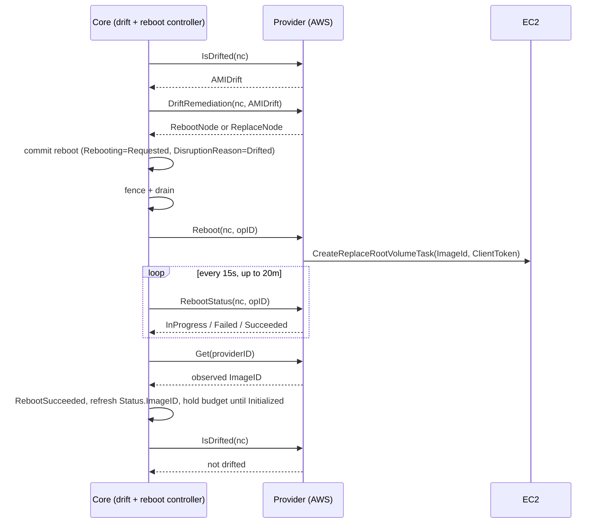

# In-Place AMI Upgrades for Drift

Let drift resolve an AMI change on an existing node by replacing its root volume, instead of terminating and replacing the node.

## Motivation

Today drift has one remedy: replace the node.
When a NodeClass resolves to a new AMI, every node on the old AMI drifts, and Karpenter launches a replacement, drains the old node and terminates it.
For most fleets that is the right call.
For nodes that hold state on instance-store volumes, or run on capacity that is hard to get back, it is expensive: terminating the instance discards the instance-store data and releases the capacity.

[#3259](https://github.com/kubernetes-sigs/karpenter/pull/3259) added `Reboot` as a node action and noted that the same lifecycle would later carry root volume replacement.
In that review the open question was how a provider decides which API to call for an in-place action.
This RFC answers it for AMI drift.
EC2 already supports the operation: [`CreateReplaceRootVolumeTask`](https://docs.aws.amazon.com/AWSEC2/latest/UserGuide/replace-root.html) swaps the root volume for one built from a new AMI on a running instance, through a reboot, and preserves instance-store volumes.
Tracking issue: [aws/karpenter-provider-aws#8735](https://github.com/aws/karpenter-provider-aws/issues/8735).

### Use Cases

- **Instance-store stateful workloads.** Shuffle data, KV stores, search indices and model caches on local NVMe take hours to rebuild. A routine AMI rollout currently forces every node through that rebuild.
- **Hard-to-reacquire capacity.** Nodes on capacity reservations or scarce instance types may not get equivalent capacity back after termination. An AMI update should not put that capacity at risk.
- **Patch compliance on long-lived nodes.** Teams that block drift on stateful pools to protect their data fall behind on OS patches. In-place upgrades let them take patches without giving up the data.

Pinterest validated the EC2 mechanism on `i4i.2xlarge`: a canary file on instance store survived `CreateReplaceRootVolumeTask` with a different AMI, and did not survive Karpenter drift.

### Non-Goals

- **User data changes.** Updating user data requires a stopped instance, and [stopping discards instance-store data](https://docs.aws.amazon.com/AWSEC2/latest/UserGuide/instance-store-lifetime.html), so it cannot meet the goal. User data drift keeps replacing.
- **Drift other than AMI.** Subnet, security group, instance type, capacity reservation and other NodeClass or NodePool drift keep replacing.
- **Rolling back to the previous image.** Core does not track image history.
- **Other providers.** This RFC defines the core hooks and the AWS behavior. Other providers inherit a default of "replace".

## Proposal

### Proposed Spec

Opt-in lives on the provider NodeClass, because every safety check is provider-specific.

```yaml
apiVersion: karpenter.k8s.aws/v1
kind: EC2NodeClass
spec:
  amiDriftPolicy: ReplaceRootVolume   # Replace (default) | ReplaceRootVolume
```

- `Replace`: today's behavior.
- `ReplaceRootVolume`: prefer an in-place root volume replacement for AMI drift. Falls back to `Replace` whenever a safety check fails or the swap fails.
- The field is excluded from the NodeClass drift hash (`hash:"ignore"`). Otherwise turning it on would mark every node on the NodeClass as drifted for a non-AMI reason, and they would all be replaced.

Two `CloudProvider` additions in core:

```go
// DriftRemediation decides how to resolve a drifted NodeClaim before core commits to it.
// Providers that do not support in-place remediation return ReplaceNode.
DriftRemediation(ctx context.Context, nodeClaim *v1.NodeClaim, reason DriftReason) (RepairAction, error)

// RebootStatus reports the provider-side state of a reboot operation.
RebootStatus(ctx context.Context, nodeClaim *v1.NodeClaim, operationID string) (RebootState, error) // InProgress | Failed | Succeeded
```

`RepairAction` (`RebootNode | ReplaceNode`) and `Reboot(ctx, nodeClaim, operationID)` already exist.

### How It Works



1. **Decide before committing.** Core only knows "AMI drift". It cannot tell whether a swap is safe for this node, and committing drains the node, so the provider answers first. `RebootNode` means safe and opted in. `ReplaceNode` means today's drift path: simulate, pre-spin a replacement, terminate.
2. **Provider gates.** AMI-level checks are computed once per NodeClass and exposed as status conditions: single root volume, no Marketplace product codes, no AL2023 with RAID0 instance store, backing snapshot readable from the node's account. Node-level checks run per NodeClaim: AMI is the only drift, AMI family, variant and Kubernetes minor version are unchanged, the instance is running, and the NodeClaim has a `terminationGracePeriod`. Every failed gate emits an event naming it.
3. **Reuse the reboot lifecycle.** Core commits the node to the existing reboot controller with `DisruptionReason=Drifted`, skipping scheduling simulation and replacement. `Reboot` has no action field: the provider reads `DisruptionReason`, the `Drifted` condition and the NodeClass, re-runs the gates, and calls `CreateReplaceRootVolumeTask`. Anything else stays `RebootInstances`.
4. **Confirm the swap, not just the reboot.** A new boot ID and `Ready` prove the node restarted, not that it runs the new root volume. A failed task that reboots on the old volume looks the same. Core waits for `RebootStatus`, and fails fast on `Failed` instead of waiting out the window.
5. **Record what is running.** Core writes `Status.ImageID` only at launch today. After success it reads the image back with `Get` so drift clears on the image the node actually runs.

### Interaction with Existing Features

- **Disruption budgets.** In-place nodes count against the `Drifted` budget until they are `Initialized` again. A `Drifted` budget of `0` stops in-place upgrades and replacements alike.
- **Blocking pods.** Drift admits nodes with PDB or `do-not-disrupt` blockers only when the NodeClaim has a `terminationGracePeriod`. The reboot drain is unbounded without one, so the same rule is a gate here.
- **Repair.** `ValidateNodeDisruptable` already blocks all other disruption while a node is rebooting. An `Unhealthy` node that is also AMI-drifted and eligible gets the root volume swap, which clears both.
- **Failure.** The reboot controller already escalates a failed reboot after disruption to NodeClaim replacement, with the drain bounded by the committed grace period. No new failure state is added.
- **Consolidation.** Unchanged. A node that finishes the swap is no longer drifted and is evaluated normally.

### Observability

- `Rebooting` condition with `DisruptionReason=Drifted` for the in-place lifecycle. The existing reboot events and metrics cover it.
- An event on every `ReplaceNode` decision naming the gate that failed.
- NodeClass status conditions for AMI-level eligibility.

### Edge Cases

- **AMI and subnet drift at once.** The AMI is not the only drift, so the node is replaced.
- **Snapshot not shared to the node's account.** The gate fails and the node is replaced. Operators fix sharing and later rollouts go in place.
- **Controller restart mid-swap.** `operationID` is passed as the EC2 `ClientToken`, so a re-issued call joins the existing task.
- **Task fails after the drain.** `RebootStatus` reports `Failed`, the reboot fails fast, and the node is replaced.

## Alternatives Considered

### `driftPolicy` on the NodePool

A core enum (`Replace | InPlacePreferred`) on `NodePool.spec.disruption`.
Rejected because every safety check is provider-specific, so core would expose a knob whose meaning it cannot define.
NodeClasses for stateful pools are already separate in practice.

### A dedicated `ReplaceImage` primitive with a target image

`DriftRemediation` returns a target image and core calls a new method with it.
Rejected because the reboot lifecycle already covers drain, fence, observe and failure.
The provider can resolve the image from the NodeClass, so core never needs to know what an image is.

### Operator tooling outside Karpenter

Scripts that call `CreateReplaceRootVolumeTask` directly.
Rejected because they bypass disruption budgets, drains and drift state, and race Karpenter's own drift.

## Backward Compatibility

- `amiDriftPolicy` defaults to `Replace` and is excluded from the drift hash. Upgrading changes nothing.
- Providers that do not implement in-place return `ReplaceNode` from `DriftRemediation`. Drift behaves as today.

## Graduation Criteria

- **Alpha:** behind a feature gate, AWS only. Proves the gates and the `RebootStatus` loop on real fleets.
- **Beta:** enabled by default after production data on swap duration across instance types, used to tune the 20 minute window.

## Open Questions

1. Names and shape of the NodeClass status conditions for AMI-level eligibility.
2. Is the 20 minute observation window right for root volume replacement? Swaps typically take 2 to 10 minutes.
3. Should the repair path (`Unhealthy` and AMI-drifted) ship with drift, or follow it?
