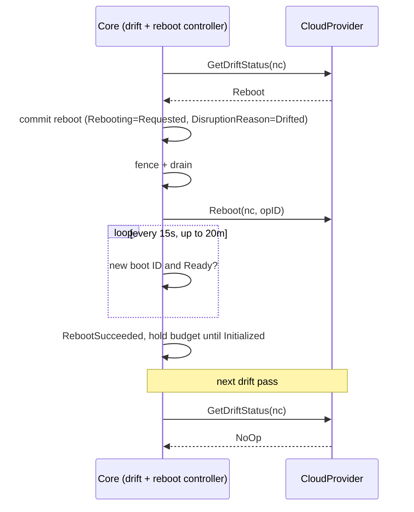

# In-Place Drift Remediation

Let a cloud provider resolve drift on an existing node in place, through the reboot lifecycle, instead of replacing the node.

## Motivation

Today drift has one remedy: replace the node.
When a NodeClass or NodePool changes, every affected node drifts, and Karpenter launches a replacement, drains the old node and terminates it.
For most fleets that is the right call.
For nodes that hold state on local disks, or run on capacity that is hard to get back, it is expensive: terminating the instance discards the local data and releases the capacity.

Some drift does not need a new instance.
A provider may be able to change the boot image of a running instance through a reboot, keeping the instance, its local disks and its capacity.
On AWS, EC2 [`CreateReplaceRootVolumeTask`](https://docs.aws.amazon.com/AWSEC2/latest/UserGuide/replace-root.html) does this for AMI drift; the AWS design is in [aws/karpenter-provider-aws#9786](https://github.com/aws/karpenter-provider-aws/pull/9786).

[#3259](https://github.com/kubernetes-sigs/karpenter/pull/3259) added `Reboot` as a node action and noted that the same lifecycle would later carry root volume replacement.
In that review the open question was how a provider decides which API to call for an in-place action.
This RFC answers it for drift: core asks the provider whether it can resolve a drifted NodeClaim in place, and runs the existing reboot lifecycle when it can.
Tracking issue: [aws/karpenter-provider-aws#8735](https://github.com/aws/karpenter-provider-aws/issues/8735).

### Use Cases

- **Stateful workloads on local disks.** Shuffle data, KV stores, search indices and model caches on local NVMe take hours to rebuild. A routine image rollout currently forces every node through that rebuild.
- **Hard-to-reacquire capacity.** Nodes on capacity reservations or scarce instance types may not get equivalent capacity back after termination. An image update should not put that capacity at risk.
- **Patch compliance on long-lived nodes.** Teams that block drift on stateful pools to protect their data fall behind on OS patches. In-place remediation lets them take patches without giving up the data.

### Non-Goals

- **Deciding which drift can be resolved in place.** That is the provider's call. Core never inspects images, user data or other provider configuration.
- **A core opt-in API.** Each provider defines its own opt-in on its NodeClass, because every safety check is provider-specific.
- **Drift a provider cannot resolve in place.** It keeps replacing.
- **Rolling back to the previous image.** Core does not track image history.

## Proposal

### Proposed Spec

No new core API fields or CRDs.

One breaking `CloudProvider` change: `GetDriftStatus` replaces `IsDrifted`.

```go
// GetDriftStatus returns whether a NodeClaim drifted, why, and how core should resolve it.
// Providers that do not support in-place remediation never return Reboot.
GetDriftStatus(ctx context.Context, nodeClaim *v1.NodeClaim) (DriftStatus, error)

type DriftStatus struct {
	// Action is NoOp when the NodeClaim has not drifted.
	Action DisruptionAction
	// Reason is written as the Drifted condition reason, as IsDrifted's DriftReason is today.
	Reason DriftReason
}
```

`DisruptionAction` is today's `RepairAction` renamed and generalized, so drift and repair share one type:

- `NoOp`: not drifted. Previously `IsDrifted` returned no reason.
- `Replace`: drifted, replace the node. Previously `IsDrifted` returned a reason.
- `Reboot`: drifted, and the provider resolves it in place through the reboot lifecycle. New.

`Reboot(ctx, nodeClaim, operationID)` already exists and is unchanged.

### How It Works



1. **Decide before committing.** Core cannot tell whether an in-place change is safe for this node, and committing drains the node, so the provider answers first through `GetDriftStatus`. `Reboot` means the provider will resolve this drift in place. `Replace` means today's drift path: simulate, pre-spin a replacement, terminate.
2. **Reuse the reboot lifecycle.** Core commits the node to the existing reboot controller with `DisruptionReason=Drifted`, skipping scheduling simulation and replacement. `Reboot` has no action field: the provider reads `DisruptionReason` and the `Drifted` condition to choose its in-place operation, and re-checks that it is still safe. Any other reason stays a plain reboot. `operationID` is the provider's idempotency key.
3. **Keep the reboot lifecycle reason-agnostic.** The reboot controller completes on a new boot ID and `Ready`, as it does for any reboot. It does not read the image back or ask about drift, so it never encodes why the node rebooted.
4. **Confirm the drift is resolved on the next drift pass.** A new boot ID and `Ready` prove the node restarted, not that the drift was resolved. A failed operation that reboots on the old image looks the same. The drift method calls `GetDriftStatus` again, as it does for every node, and the provider answers from its own record of the operation rather than from eventually consistent read APIs: `NoOp` when the change landed, `Replace` when it failed. `Replace` takes today's drift path, so the replacement launches before the node is drained. As a backstop, drift reuses the repair path's `RebootHistory`, so a NodeClaim that keeps asking for `Reboot` is replaced instead of rebooted again.

### Interaction with Existing Features

- **Disruption budgets.** In-place nodes count against the `Drifted` budget until they are `Initialized` again. A `Drifted` budget of `0` stops in-place remediation and replacements alike.
- **Blocking pods.** Drift admits nodes with PDB or `do-not-disrupt` blockers only when the NodeClaim has a `terminationGracePeriod`.
- **Repair.** `ValidateNodeDisruptable` already blocks all other disruption while a node is rebooting. An `Unhealthy` node that is also drifted can be resolved by the same in-place operation when the provider supports it.
- **Failure.** The reboot controller already escalates a failed reboot after disruption to NodeClaim replacement, with the drain bounded by the committed grace period. No new failure state is added.
- **Consolidation.** Unchanged. A node that finishes in-place remediation is no longer drifted and is evaluated normally.

### Observability

- `Rebooting` condition with `DisruptionReason=Drifted` for the in-place lifecycle. The existing reboot events and metrics cover it.
- An event on every `Replace` decision for a NodeClaim whose provider supports in-place remediation.

### Edge Cases

- **More than one drift reason.** The provider returns `Replace` unless it can resolve every reason in place.
- **Controller restart mid-operation.** `Reboot` is called again with the same `operationID`, so the provider joins the existing operation.
- **Operation fails and the node reboots on the old image.** The reboot succeeds, the next `GetDriftStatus` returns `Replace`, and the node is replaced through today's drift path.
- **Operation fails before the node reboots.** No new boot ID appears, so the reboot fails when the observation window ends and the node is replaced. The node stays drained for that window.

## Alternatives Considered

### `driftPolicy` on the NodePool

A core enum (`Replace | InPlacePreferred`) on `NodePool.spec.disruption`.
Rejected because every safety check is provider-specific, so core would expose a knob whose meaning it cannot define.
NodeClasses for stateful pools are already separate in practice.

### A dedicated `ReplaceImage` primitive with a target image

`GetDriftStatus` returns a target image and core calls a new method with it.
Rejected because the reboot lifecycle already covers drain, fence, observe and failure.
The provider can resolve the image from its NodeClass, so core never needs to know what an image is.

### Separate `DriftRemediation` and `RebootStatus` hooks

Keep `IsDrifted`, add `DriftRemediation` to choose between in-place and replace, and add `RebootStatus` so core polls the provider for the operation's state.
Rejected because `GetDriftStatus` answers both questions with one method: before the reboot it picks the action, and on the next drift pass it confirms the drift is gone.
The cost is fail-fast: an operation that fails before the node reboots is detected when the observation window ends rather than immediately.

### Operator tooling outside Karpenter

Scripts that call the provider's in-place APIs directly.
Rejected because they bypass disruption budgets, drains and drift state, and race Karpenter's own drift.

## Backward Compatibility

- No new core API fields or CRDs. Users see no change until their provider returns `Reboot`.
- Breaking for providers: `IsDrifted` is replaced by `GetDriftStatus`, and `RepairAction` is renamed to `DisruptionAction`. A provider migrates by returning `NoOp` where `IsDrifted` returned no reason and `Replace` with that reason where it returned one, so drift behaves as today. Repair policies move to the renamed type.

## Graduation Criteria

- **Alpha:** no core feature gate. Each provider's NodeClass opt-in is the gate and is off by default. Proves the `GetDriftStatus` decision and the post-reboot drift check with one provider (AWS) on real fleets.
- **Beta:** after production data on operation duration, used to tune the 20 minute window.

## Open Questions

1. Is the 20 minute observation window right, or should the provider supply it per operation? AWS root volume replacements typically take 2 to 10 minutes.
2. Should the repair path (`Unhealthy` and drifted) ship with drift, or follow it?
3. After an in-place change, `Status.ImageID` still holds the launch image, because core no longer reads it back. Should core keep it current outside the reboot lifecycle, or is that the provider's job?
