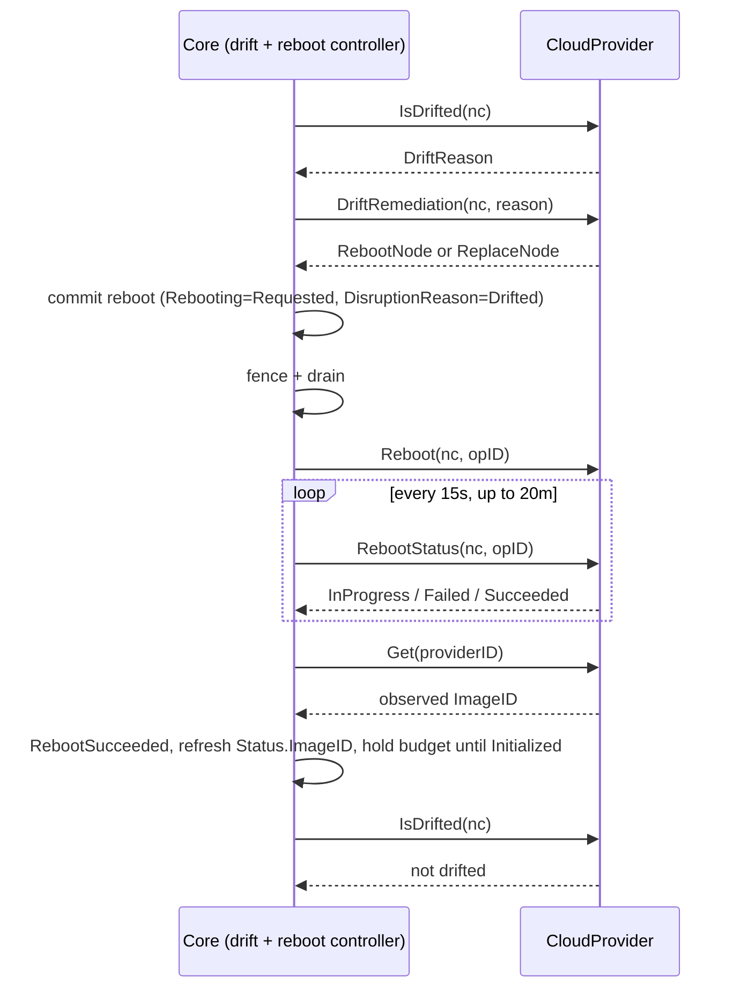

# In-Place Drift Remediation

Let a cloud provider resolve drift on an existing node in place, through the reboot lifecycle, instead of replacing the node.

## Motivation

Today drift has one remedy: replace the node.
When a NodeClass or NodePool changes, every affected node drifts, and Karpenter launches a replacement, drains the old node and terminates it.
For most fleets that is the right call.
For nodes that hold state on local disks, or run on capacity that is hard to get back, it is expensive: terminating the instance discards the local data and releases the capacity.

Some drift does not need a new instance.
A provider may be able to change the boot image of a running instance through a reboot, keeping the instance, its local disks and its capacity.
On AWS, EC2 [`CreateReplaceRootVolumeTask`](https://docs.aws.amazon.com/AWSEC2/latest/UserGuide/replace-root.html) does this for AMI drift; the AWS design is in [aws/karpenter-provider-aws#9786](https://github.com/aws/karpenter-provider-aws/pull/9786).

[#3259](https://github.com/kubernetes-sigs/karpenter/pull/3259) added `Reboot` as a node action and noted that the same lifecycle would later carry root volume replacement.
In that review the open question was how a provider decides which API to call for an in-place action.
This RFC answers it for drift: core asks the provider whether it can resolve a drifted NodeClaim in place, and runs the existing reboot lifecycle when it can.
Tracking issue: [aws/karpenter-provider-aws#8735](https://github.com/aws/karpenter-provider-aws/issues/8735).

### Use Cases

- **Stateful workloads on local disks.** Shuffle data, KV stores, search indices and model caches on local NVMe take hours to rebuild. A routine image rollout currently forces every node through that rebuild.
- **Hard-to-reacquire capacity.** Nodes on capacity reservations or scarce instance types may not get equivalent capacity back after termination. An image update should not put that capacity at risk.
- **Patch compliance on long-lived nodes.** Teams that block drift on stateful pools to protect their data fall behind on OS patches. In-place remediation lets them take patches without giving up the data.

### Non-Goals

- **Deciding which drift can be resolved in place.** That is the provider's call. Core never inspects images, user data or other provider configuration.
- **A core opt-in API.** Each provider defines its own opt-in on its NodeClass, because every safety check is provider-specific.
- **Drift a provider cannot resolve in place.** It keeps replacing.
- **Rolling back to the previous image.** Core does not track image history.

## Proposal

### Proposed Spec

No new core API fields or CRDs.

Two `CloudProvider` additions:

```go
// DriftRemediation decides how to resolve a drifted NodeClaim before core commits to it.
// Providers that do not support in-place remediation return ReplaceNode.
DriftRemediation(ctx context.Context, nodeClaim *v1.NodeClaim, reason DriftReason) (RepairAction, error)

// RebootStatus reports the provider-side state of a reboot operation.
RebootStatus(ctx context.Context, nodeClaim *v1.NodeClaim, operationID string) (RebootState, error) // InProgress | Failed | Succeeded
```

`RepairAction` (`RebootNode | ReplaceNode`) and `Reboot(ctx, nodeClaim, operationID)` already exist.

### How It Works



1. **Decide before committing.** Core only knows the drift reason. It cannot tell whether an in-place change is safe for this node, and committing drains the node, so the provider answers first. `RebootNode` means the provider will resolve this drift in place. `ReplaceNode` means today's drift path: simulate, pre-spin a replacement, terminate.
2. **Reuse the reboot lifecycle.** Core commits the node to the existing reboot controller with `DisruptionReason=Drifted`, skipping scheduling simulation and replacement. `Reboot` has no action field: the provider reads `DisruptionReason` and the `Drifted` condition to choose its in-place operation, and re-checks that it is still safe. Any other reason stays a plain reboot. `operationID` is the provider's idempotency key.
3. **Confirm the operation, not just the reboot.** A new boot ID and `Ready` prove the node restarted, not that the drift was resolved. A failed operation that reboots on the old image looks the same. Core waits for `RebootStatus`, and fails fast on `Failed` instead of waiting out the window.
4. **Record what is running.** Core writes `Status.ImageID` only at launch today. After success it reads the image back with `Get`, so drift clears on the image the node actually runs.

### Interaction with Existing Features

- **Disruption budgets.** In-place nodes count against the `Drifted` budget until they are `Initialized` again. A `Drifted` budget of `0` stops in-place remediation and replacements alike.
- **Blocking pods.** Drift admits nodes with PDB or `do-not-disrupt` blockers only when the NodeClaim has a `terminationGracePeriod`. The reboot drain is unbounded without one, so in-place remediation requires it too: core takes the replace path for a NodeClaim without a `terminationGracePeriod`, without asking the provider.
- **Repair.** `ValidateNodeDisruptable` already blocks all other disruption while a node is rebooting. An `Unhealthy` node that is also drifted can be resolved by the same in-place operation when the provider supports it.
- **Failure.** The reboot controller already escalates a failed reboot after disruption to NodeClaim replacement, with the drain bounded by the committed grace period. No new failure state is added.
- **Consolidation.** Unchanged. A node that finishes in-place remediation is no longer drifted and is evaluated normally.

### Observability

- `Rebooting` condition with `DisruptionReason=Drifted` for the in-place lifecycle. The existing reboot events and metrics cover it.
- An event on every `ReplaceNode` decision, carrying the provider's reason.

### Edge Cases

- **More than one drift reason.** The provider returns `ReplaceNode` unless it can resolve every reason in place.
- **Controller restart mid-operation.** `Reboot` is called again with the same `operationID`, so the provider joins the existing operation.
- **Operation fails after the drain.** `RebootStatus` reports `Failed`, the reboot fails fast, and the node is replaced.

## Alternatives Considered

### `driftPolicy` on the NodePool

A core enum (`Replace | InPlacePreferred`) on `NodePool.spec.disruption`.
Rejected because every safety check is provider-specific, so core would expose a knob whose meaning it cannot define.
NodeClasses for stateful pools are already separate in practice.

### A dedicated `ReplaceImage` primitive with a target image

`DriftRemediation` returns a target image and core calls a new method with it.
Rejected because the reboot lifecycle already covers drain, fence, observe and failure.
The provider can resolve the image from its NodeClass, so core never needs to know what an image is.

### Operator tooling outside Karpenter

Scripts that call the provider's in-place APIs directly.
Rejected because they bypass disruption budgets, drains and drift state, and race Karpenter's own drift.

## Backward Compatibility

- No core API changes. Upgrading changes nothing.
- Providers that do not implement in-place return `ReplaceNode` from `DriftRemediation`. Drift behaves as today.

## Graduation Criteria

- **Alpha:** behind a feature gate. Proves the `DriftRemediation` decision and the `RebootStatus` loop with one provider (AWS) on real fleets.
- **Beta:** enabled by default after production data on operation duration, used to tune the 20 minute window.

## Open Questions

1. Is the 20 minute observation window right, or should the provider supply it per operation? AWS root volume replacements typically take 2 to 10 minutes.
2. Should the repair path (`Unhealthy` and drifted) ship with drift, or follow it?
3. Does the feature gate belong in core, in each provider, or both?
