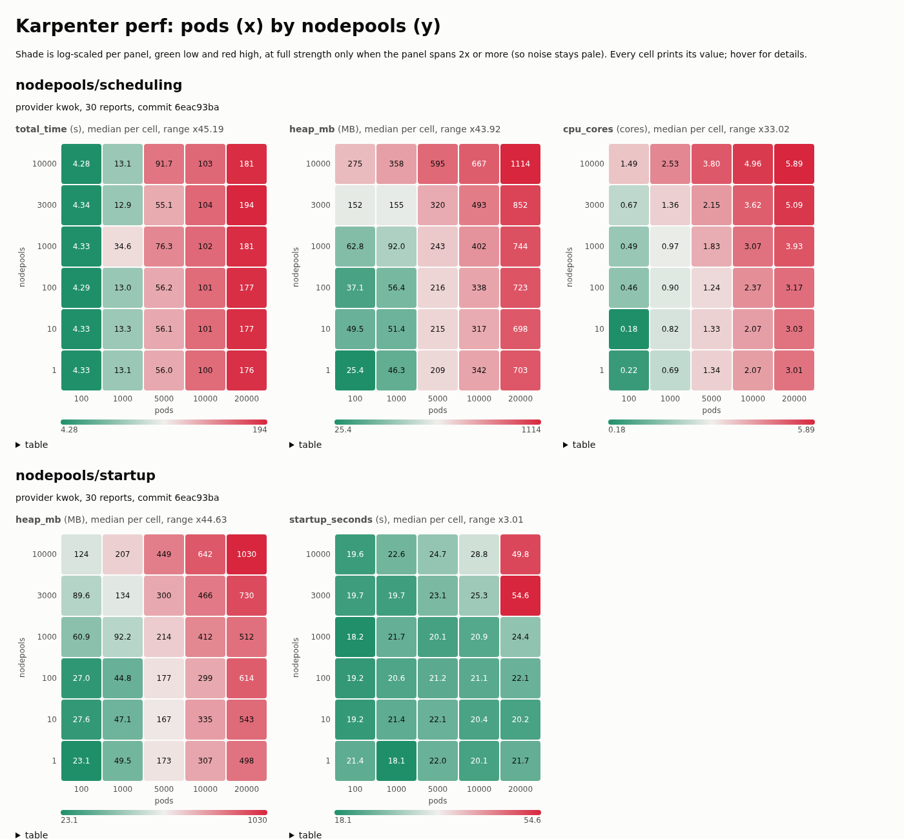

# Performance suite v2

A self-contained, plugin-style perf suite. Shared scenarios live in `perf/scenarios`, the library in `perf`, and copied dependencies in `env`. This directory's `suite_test.go`, `kwok_provider.go` and `kwok_ci_provider.go` are the core KWOK provider's plugins. Other KWOK-based providers (EKS Auto) write the same two files against `perf`, and don't copy any tests.

## Three layers

| Layer | Workflow | When | Provider | What fails |
|---|---|---|---|---|
| Smoke | `perf-smoke.yaml` | every PR | `kwok-ci`: small sizes on a GitHub kind runner | Stable gates, set only to catch gross regressions |
| Periodic | `perf-periodic.yaml` | daily, 3 runs per scenario | `kwok-ci` | the same gates. Reports are kept 90 days, for trends and for the evidence to promote a gate |
| Release | `perf-release.yaml` | dispatched before a release | `kwok-ci` sweep | nothing: the sweep is measured, and `perf.html` is uploaded |

`kwok` is the reference environment: dedicated hardware and default sizes. Its levels and the large sweep below come from an EKS cluster. Runner noise means `kwok` bounds don't transfer to `kwok-ci`, so each provider has its own calibration file.

To show the smoke test catches a regression, dispatch `perf-smoke` with `regression: mconc1`. Any patch in `perf/regressions/` works.

## Audit it: `make perf-inventory`

The inventory prints every phase's gated and measured metrics, grouped by kind (duration, outcome, resource). Each bound comes with the calibration evidence behind it. It's generated from the same values the suite runs, plus the checked-in `calibration/<provider>.json`, and it needs no cluster.

The command fails in two cases:
- A level names an undeclared phase.
- A Stable gate lacks evidence: it needs at least 3 baseline runs, a CV of at most 20%, and at least one planted regression that breaches it.

```
| phase | kind | metric | level | bound | n | median | CV | headroom | catches |
|---|---|---|---|---|---|---|---|---|---|
| pods/scaleOut | duration | total_time_seconds | measured | - | 5 | 17.501 | 7% |  |  |
| pods/scaleOut | duration | pod_ready_seconds_p50 | measured | - | 5 | 9 | 6% |  |  |
| pods/scaleOut | duration | pod_ready_seconds_p95 | stable | < 16 s | 5 | 14 | 12% | 1.14x | mconc1 (+2079%) |
| pods/scaleOut | duration | pod_ready_seconds_p99 | stable | < 18 s | 5 | 14 | 7% | 1.29x | mconc1 (+2264%) |
| pods/scaleOut | duration | pod_ready_seconds_max | experimental | < 19 s | 5 | 16 | 7% | 1.19x | mconc1 (+1981%) |
| pods/scaleOut | outcome | cpu_util | experimental | > 0.759 fraction | 5 | 0.878 | 2% | 1.16x |  |
| pods/scaleOut | outcome | memory_util | experimental | > 0.713 fraction | 5 | 0.827 | 2% | 1.16x |  |
| pods/scaleOut | outcome | nodes | experimental | < 182 nodes | 5 | 159 | 2% | 1.14x |  |
| pods/scaleOut | resource | heap_mb | stable | < 75.5 MB | 5 | 65.375 | 4% | 1.15x | rv3211 (+24%) |
| pods/scaleOut | resource | cpu_cores | experimental | < 0.87 cores | 5 | 0.722 | 6% | 1.20x |  |
| nodepools/scheduling | duration | total_time_seconds | stable | < 5 s | 5 | 4.37 | 2% | 1.14x | mconc1 (+283%) |
...

Stable needs n >= 3, CV <= 20% and at least one catch. Headroom is how far the median sits from the bound: the smallest regression the gate can see.
```

To recalibrate, put baselines in `base-*/` and regressions in `<patch>/` directories, then run:

```sh
make perf-calibrate DIR=runs/ SOURCE="cluster, controller size"                  # rewrites calibration/kwok.json
make perf-calibrate DIR=runs/ PROVIDER=kwok-ci SOURCE="GitHub kind runner"     # rewrites calibration/kwok-ci.json
```

Headroom is the median's distance from the bound, which is the smallest regression the gate can see. `catches` are the planted regressions that breach the bound, with their change from the baseline median.

## Concepts

- **Vector:** a size knob, for example `pods` or `nodepools`.
- **Scenario:** a workload shape. It declares a default size per vector, can declare several vectors, and can declare a sweep grid over them.
- **Phase:** one measured window of a scenario, for example `pods/scaleOut`.
- **Levels:** set per provider, per phase and metric.
  - `Stable`: a breach fails the spec.
  - `Experimental`: a breach is reported and warned about, but never fails.
  - Unlisted: the phase is off.
- **Metric:** carries its own `Measures` and `OnBreach` text, so alarms are generated rather than hand-written. Every metric is in seconds, MB or cores.
- **Pod latency quantiles:** `perf.PodReady.P50/P95/P99/Max` are separate metrics. Each one measures pods' creation-to-Ready seconds over pods created during the phase, and each gets its own level.
  - Typically you gate p95 and warn on p99 and max: max is the slowest customer's experience, but it's noisier.
  - `Validate` rejects bounds that decrease across quantiles.
  - It also rejects a phase that gates both `total_time_seconds` and `pod_ready_seconds_max`, since they measure nearly the same thing.

| Scenario | Vectors (default) | Phases | What it stresses |
|---|---|---|---|
| `pods` | pods=1000 | `scaleOut`, `consolidation` | provisioning throughput and disruption cost |
| `nodepools` | nodepools=1000, pods=100 | `scheduling`, `startup` | per-NodePool cost: N-1 NodePools carry a tenant taint the pods don't tolerate |
| `topology` | pods=1000 | `scaleOut` | hard constraints: hostname anti-affinity, zonal and hostname topology spread |

## Writing a scenario

```go
var Topology = perf.Scenario{
	Name:    "topology",
	Summary: "N pods with hostname anti-affinity and zonal/hostname topology spread.",
	Vectors: map[perf.Vector]int{perf.VectorPods: 1000},
	Phases:  []perf.PhaseSpec{{Name: "scaleOut", Summary: "Topology groups and domain counting."}},
	Run: func(r *perf.Run) {
		n := r.Size(perf.VectorPods)
		anti := r.Deployment("anti", n/10, "900m", "3100Mi", test.WithPodAntiAffinityHostname())
		...
		p := r.StartPhase("scaleOut")
		r.Create(r.NodeClass, r.NodePool, anti, zone, host)
		p.AwaitScaleOut(n, 20*time.Minute)
	},
}
```

How it works:
- `Run` labels and cleans up everything it creates. A spec fails up front if an earlier one left labeled objects behind.
- `StartPhase` fails on an undeclared phase, and on a phase the provider hasn't set levels for. An empty levels entry means measure only.
- The phase scrapes the leader's `/metrics` every 2 s through the API server proxy, and fails if the controller restarts mid-phase.

## Levels (per provider)

```go
Levels: perf.Levels{
	"pods/scaleOut":     {perf.HeapMB.Stable(150), perf.CPUCores.Experimental(0.7)},
	"nodepools/startup": {perf.StartupSeconds.Stable(60)},
},
```

Promote a gate to Stable when all of these hold:
1. 20 or more main runs.
2. CV of at most 20%.
3. A bound of at least 1.1x the observed max.
4. A patch in `perf/regressions/` breaches it.

Gate wall-clock consolidation time only as Experimental.

## Scaling two vectors together: sweeps and `make perf-plot`

A scenario's `Sweep` declares a grid. `KARPENTER_PERF_SWEEP=nodepools` runs one spec per cell. Sweep cells are measured, never gated, and each report records its `sizes` and the controller `commit`.

```sh
OUTPUT_DIR=/tmp/sweep KARPENTER_PERF_SWEEP=nodepools TEST_SUITE=Performancev2 make e2etests
KARPENTER_PERF_SWEEP_GRID='{"pods":[100,500],"nodepools":[1,100]}' ...   # smaller grid
make perf-plot DIR=/tmp/sweep    # writes perf.html
```



This is the 30-cell `nodepools` sweep on EKS. Setup:
- **Cluster:** an EKS cluster with a tier-xl provisioned control plane.
- **Controller:** 14 CPU / 56 Gi on a dedicated m7i.4xlarge.
- **Grid:** pods [100…20000] × nodepools [1…10000], all 30 cells passing.
- **Commit:** upstream main 6eac93ba.

What it shows:
- **Scale-out time is bound by node registration.** It's about 180 s at 20k pods regardless of NodePool count.
- **NodePool cost lands in heap and CPU.** That's why the `nodepools` levels gate on those.

  | | 1 NodePool | 10k NodePools |
  |---|---|---|
  | Heap at 100 pods | 25 MB | 275 MB |
  | Heap at 20k pods | 703 MB | 1114 MB |
  | CPU at 20k pods | 3.0 cores | 5.9 cores |

- **Startup has a cliff only where both vectors are high.** It's about 20 s across most of the grid, but 50-55 s at 3000+ NodePools × 20k pods, with 1 GB of heap at 10k × 20k.

`perf.html` has one heat map per phase and metric, with pods on x and NodePools on y:
- The shade is log-scaled, from green (the panel's lowest value) to red (its highest).
- Every cell prints its value, and hovering shows sizes and run count.
- Each panel has a table view.

## Running

```sh
OUTPUT_DIR=$(mktemp -d) TEST_SUITE=Performancev2 FOCUS=nodepools make e2etests
KARPENTER_PERF_PROVIDER=kwok-ci ...                                 # the smoke sizes and levels
KARPENTER_PERF_SIZES='{"nodepools":10000}' ...                     # override a vector for every scenario
KARPENTER_PERF_THRESHOLDS='{"pods/scaleOut":{"heap_mb":200}}' ...  # per-runner bounds
```

## Regression patches

`perf/regressions/` holds one-line mutations and clean reverts of known perf fixes, each a patch against main. Its [README](perf/regressions/README.md) has the measured table of which layer catches which regression: Go microbenchmarks, kind e2e, and v2 on EKS at default and large sizes.

The KWOK levels above come from 5 baselines on an EKS cluster with a tier-xl provisioned control plane. `pods/scaleOut` time and heap are Stable because a planted regression breaches them: concurrency forced to 1 breaches time, and reverting #1973 or #3211 breaches heap. Everything else stays Experimental until 20 main runs hold.

## Review standard

Every PR that adds or changes a perf test shows:
1. It catches a patch from `perf/regressions/`, and doesn't breach on a negative control.
2. 5 base runs with median, max and CV for each gated metric.
3. Where each bound comes from, and the regression size it lets through (bound / median - 1).
4. No Stable wall-clock gate on consolidation or drift.
5. It isn't duplicated in an open PR or an existing scenario.
6. It fails loudly on a controller restart.
7. What it costs, in minutes per run.
